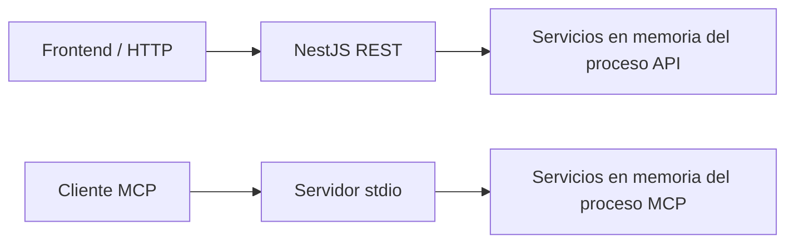

# TodoList API + MCP

Gestión de listas y tareas mediante dos interfaces: una API REST en NestJS y un servidor MCP con siete herramientas para clientes de IA compatibles.

**TypeScript · NestJS · Model Context Protocol · Jest**

[Frontend React](https://github.com/FelipeH99/Todo-list-FE) · [Guía de uso y endpoints](docs/usage.md) · [Implementación](README-IMPLEMENTACION.md)

## Qué demuestra

- Reutilización de servicios de negocio desde HTTP y MCP.
- Herramientas para crear listas, agregar tareas, consultarlas, editarlas, completarlas y eliminarlas.
- Contratos tipados y pruebas de API.



**Cada proceso mantiene datos independientes en memoria.** API y MCP no comparten tareas y los datos se pierden al reiniciar. El proyecto no incluye autenticación ni base de datos.

## Probar la API

```sh
git clone https://github.com/FelipeH99/todo-list-mcp-challenge.git
cd todo-list-mcp-challenge
npm ci
npm run start:dev
```

En otra terminal:

```sh
curl -X POST http://localhost:3000/api/todolists \
  -H 'Content-Type: application/json' -d '{"name":"Trabajo"}'
curl http://localhost:3000/api/todolists
```

## Conectar MCP

```sh
npm run build
```

Configurá tu cliente MCP con una entrada de este tipo, reemplazando la ruta absoluta:

```json
{
  "mcpServers": {
    "todo-mcp-server": {
      "command": "node",
      "args": ["/ruta/todo-list-mcp-challenge/dist/mcp/mcp-server.js"]
    }
  }
}
```

El cliente inicia el proceso por stdio; no necesita que la API HTTP esté encendida. Podés pedirle que cree una lista, agregue una tarea y la marque como completada. La interpretación en lenguaje natural depende del cliente y su modelo; este repositorio implementa las herramientas MCP.

## Validación

```sh
npm run build
npm test -- --runInBand
npm run test:e2e -- --runInBand
```

## Próxima evolución

Persistencia compartida, validación de argumentos MCP, pruebas de herramientas e integración con una automatización real. Incorporar MCP expone capacidades a un cliente; por sí solo no convierte la aplicación en un agente autónomo.
